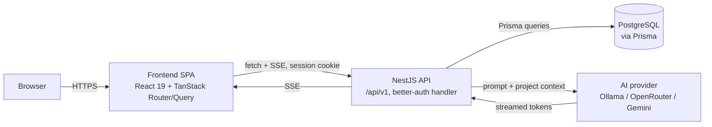
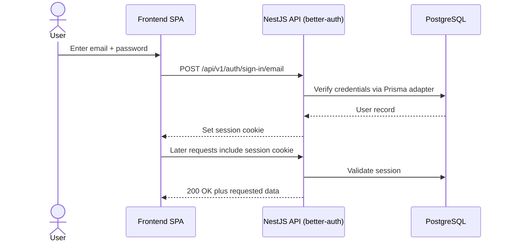

# lmesh CMF Assistant

A web application for automotive designers to create design projects and chat
with an AI assistant about design direction, colour-material-finish (CMF)
themes, and material choices, with the assistant kept aware of each project's
context (see `docs/requirements.md` for the full brief this project was built
against). The target user flow:

1. A user logs in (seed user, no public registration).
2. They create a **design project** with a title and an optional description
   of the design context (e.g. "warm earth tones, matte leather, premium SUV
   interior").
3. Inside a project, they **chat with an AI assistant** that is aware of the
   project's context, with the response streaming in progressively.
4. They can ask the AI to **summarise the key design decisions** made during
   the conversation.
5. They can **reset the conversation** without losing the project itself.

**Current status:** this is an early scaffold. The backend currently exposes
only a health check endpoint, a `User` Prisma model/migration, and a seed
script that creates a test user with a bcrypt-hashed password; there is no
authentication, project, or AI/chat module yet. The frontend currently has
only a single placeholder route. The product features described above are
the target scope (see `docs/requirements.md`), not yet implemented.

Authentication is planned to use [better-auth](https://better-auth.com) (see
[Authentication](#authentication) below); it is not installed yet
(`apps/backend/package.json` has no `better-auth` dependency), so the current
`User` model and bcrypt-hashed `password_hash` column are a placeholder that
is expected to be replaced or extended once better-auth's own Prisma-managed
tables (`user`, `session`, `account`, `verification`) are generated.

## Repo structure

This is a [Turborepo](https://turborepo.dev) monorepo managed with pnpm workspaces.

- `apps/backend` — API server: NestJS 11 (Fastify adapter), Prisma, PostgreSQL.
- `apps/frontend` — SPA: React 19, TanStack Router, TanStack Query, Zustand, Tailwind CSS v4 + shadcn/ui, served by Vite in dev and nginx in Docker.
- `packages/eslint-config` — shared ESLint configurations.
- `packages/typescript-config` — shared `tsconfig.json` bases.

## Tech stack

- **Backend:** NestJS 11 + Fastify, Prisma 7 (`@prisma/adapter-pg`), PostgreSQL 17, class-validator, Vitest. `bcryptjs` is currently used only by the seed script (see Current status); planned auth uses [better-auth](https://better-auth.com) with its Prisma adapter instead.
- **Frontend:** React 19, TanStack Router v1, TanStack Query v5, Zustand, Tailwind CSS v4, Radix UI + shadcn/ui (`apps/frontend/components.json`), Vite, Vitest.
- **Tooling:** Turborepo, pnpm workspaces, ESLint, Prettier, TypeScript, Docker / Docker Compose.
- **AI provider config:** the backend's env schema (`AI_PROVIDER`: `ollama` | `openrouter` | `gemini`, plus related model/key vars) anticipates Ollama, OpenRouter, or Gemini, but no AI/chat module or LLM client is implemented yet.

## Architecture (target)



The frontend never talks to the AI provider or the database directly; the
NestJS API is the single entry point, enforces the session on every route,
scopes data to the authenticated user's own projects, and streams AI tokens
back to the browser over SSE as they arrive.

### Login / session flow (better-auth, target)



There is no public sign-up endpoint: per `docs/requirements.md`, the seed
script creates the one login-ready user (see
[Running with Docker Compose](#running-with-docker-compose) for its
credentials).

## Authentication

Auth is planned around [better-auth](https://better-auth.com):

- **Email/password** sign-in only — no self-service registration; the seed
  script provisions the test user.
- **Session cookies**, not JWTs issued by the app, configured through
  `BETTER_AUTH_SECRET` and `BETTER_AUTH_URL`.
- **Prisma adapter** (`better-auth/adapters/prisma` with `@prisma/adapter-pg`)
  so better-auth's `user`/`session`/`account`/`verification` tables live in
  the same PostgreSQL database as the rest of the app.
- **Mounted inside NestJS** behind the existing Fastify adapter, under the
  `/api/v1` prefix (exact route, e.g. `/api/v1/auth/*`, to be fixed by the
  API contract); every other route requires a valid session.

This is the chosen approach, not yet implemented — see **Current status**
above.

## Prerequisites

- Node.js `>= 24` (root `package.json` `engines`)
- pnpm `11.25.0` (root `package.json` `packageManager`)
- Docker and Docker Compose, if you want to run the full stack via Compose

## Setup

Install dependencies from the repo root:

```sh
pnpm install
```

Copy the environment file templates:

```sh
cp .env.example .env
cp apps/frontend/.env.example apps/frontend/.env   # optional, has working defaults
```

### Environment variables (root `.env`)

Used by Docker Compose and by the backend when run locally. Every variable has
a default (see `.env.example`):

| Variable                                                                                                | Purpose                                                                                                                     |
| ------------------------------------------------------------------------------------------------------- | --------------------------------------------------------------------------------------------------------------------------- |
| `FRONTEND_PORT`, `BACKEND_PORT`, `POSTGRES_PORT`, `OLLAMA_PORT`                                         | Host-side port mappings                                                                                                     |
| `POSTGRES_USER`, `POSTGRES_PASSWORD`, `POSTGRES_DB`                                                     | PostgreSQL credentials/database name                                                                                        |
| `DATABASE_URL`                                                                                          | Prisma/backend connection string (points at `localhost` for local dev; overridden to the `postgres` service inside Compose) |
| `NODE_ENV`, `HOST`, `PORT`                                                                              | Backend runtime env, bind address/port                                                                                      |
| `CORS_ORIGIN`                                                                                           | Allowed browser origin for the API                                                                                          |
| `SEED_ON_START`                                                                                         | Runs the idempotent seed script on backend container start                                                                  |
| `BETTER_AUTH_SECRET`, `BETTER_AUTH_URL`                                                                 | better-auth signing secret (≥ 32 chars, required) and the public origin the browser uses                                    |
| `AI_PROVIDER`                                                                                           | `openrouter` (default) \| `ollama` \| `gemini` (validated at boot; no AI module consumes it yet)                            |
| `AI_REQUEST_TIMEOUT_MS`, `AI_FIRST_TOKEN_TIMEOUT_MS`, `AI_HISTORY_MAX_MESSAGES`, `AI_HISTORY_MAX_CHARS` | AI call timeouts and conversation history limits                                                                            |
| `AI_FAULT_INJECTION`                                                                                    | Test-only fault injection for e2e; keep `false` (only `docker-compose.e2e.yml` enables it)                                  |
| `OLLAMA_BASE_URL`, `OLLAMA_MODEL`                                                                       | Ollama connection (defaults to the host machine)                                                                            |
| `OPENROUTER_API_KEY`, `OPENROUTER_MODEL`                                                                | OpenRouter credentials/model                                                                                                |
| `GEMINI_API_KEY`, `GEMINI_MODEL`                                                                        | Gemini credentials/model                                                                                                    |

The frontend's `apps/frontend/.env.example` additionally defines
`VITE_API_BASE_URL` (baked in at build time) and `VITE_DEV_API_PROXY_TARGET`
(dev-server proxy target for `/api`).

## Running locally (without Docker)

You need a reachable PostgreSQL instance (e.g. `docker compose up postgres`,
or your own local Postgres) matching `DATABASE_URL` in `.env`. Apply migrations
and seed the test user before starting the app for the first time:

```sh
pnpm --filter backend prisma:migrate:deploy
pnpm --filter backend db:seed
pnpm dev
```

`pnpm dev` runs `turbo run dev` for all apps:

- Backend: generates the Prisma client then starts NestJS in watch mode — API at `http://localhost:3000/api/v1`, Swagger UI at `http://localhost:3000/api/docs`.
- Frontend: Vite dev server at `http://localhost:5173`, proxying `/api` to the backend.

## Running with Docker Compose

```sh
docker compose up --build
```

Services (ports are host-side, from `.env`/`docker-compose.yml` defaults):

| Service             | URL                          | Notes                                                                                                       |
| ------------------- | ---------------------------- | ----------------------------------------------------------------------------------------------------------- |
| `frontend`          | http://localhost:5173        | nginx serving the built SPA, proxies `/api` to `backend`                                                    |
| `backend`           | http://localhost:3000/api/v1 | Swagger docs at `/api/docs`; runs Prisma migrations and the seed script on start                            |
| `postgres`          | localhost:5432               | PostgreSQL 17 (Alpine)                                                                                      |
| `ollama` (optional) | localhost:11434              | Only started with `docker compose --profile ollama up`; set `OLLAMA_BASE_URL=http://ollama:11434` to use it |

On backend startup, pending Prisma migrations are applied and, if
`SEED_ON_START=true` (the default), the database is seeded with a test user:

```
test@lmesh.eu / password
```

## Other scripts

From the repo root (run via Turborepo across all apps/packages):

```sh
pnpm build         # turbo run build
pnpm lint           # turbo run lint
pnpm check-types    # turbo run check-types
pnpm test           # turbo run test
pnpm format         # prettier --write "**/*.{ts,tsx,md}"
```

Backend-specific (run from the repo root with `pnpm --filter backend <script>`):

```sh
pnpm --filter backend prisma:generate        # generate the Prisma client
pnpm --filter backend prisma:migrate         # create/apply a dev migration
pnpm --filter backend prisma:migrate:deploy  # apply pending migrations (used in Docker)
pnpm --filter backend db:seed                # run the idempotent seed script
pnpm --filter backend test:watch             # Vitest in watch mode
```

Frontend-specific (run from the repo root with `pnpm --filter frontend <script>`):

```sh
pnpm --filter frontend preview     # preview the production build
pnpm --filter frontend test:watch  # Vitest in watch mode
```
